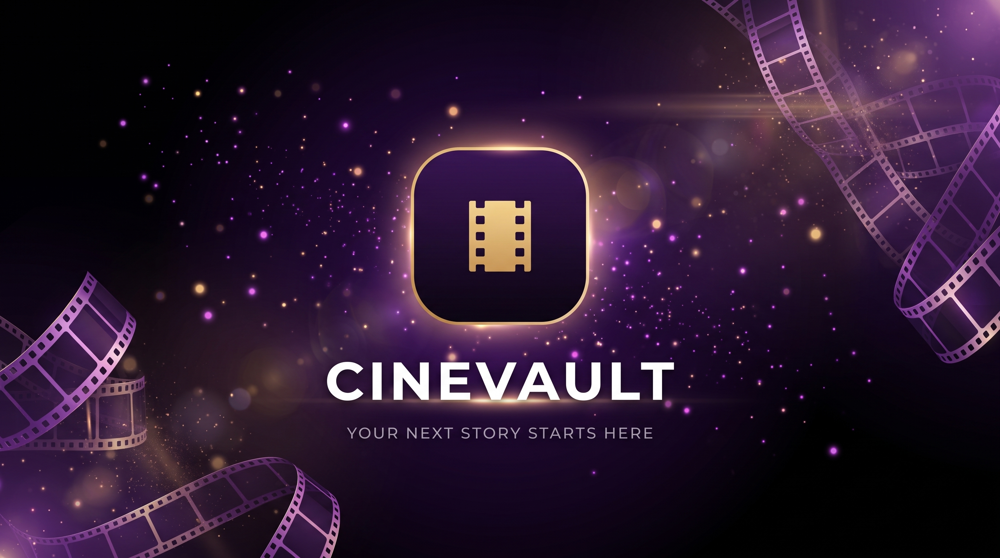
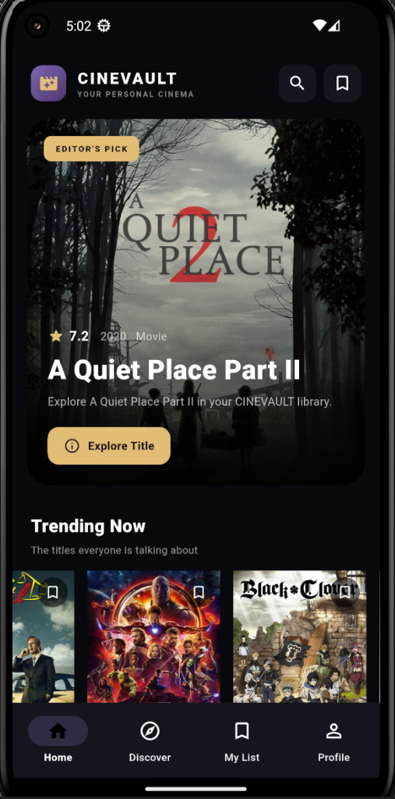
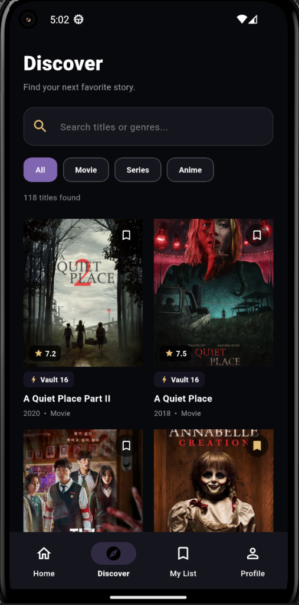
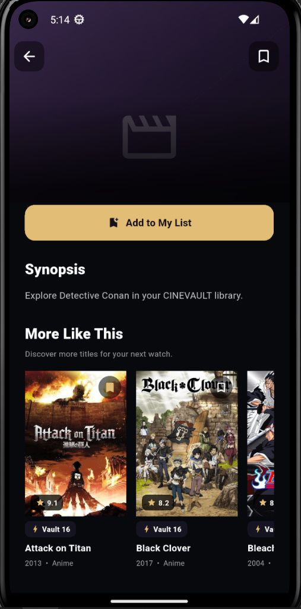
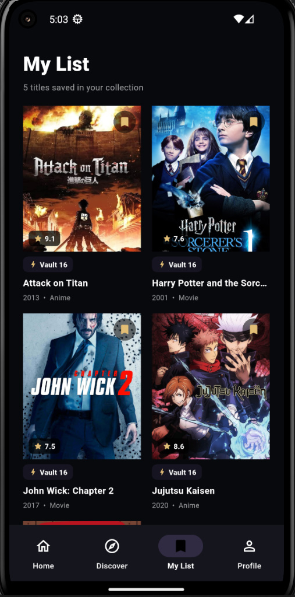

<div align="center">

# 🎬 CINEVAULT


### Your Next Favorite Story Starts Here.

**A Flutter-powered movie and series discovery experience.**

Explore a curated library of movies, series, and anime through a dark, cinematic interface designed for discovering and organizing entertainment.

<br>

[▶ Watch Demo](#-LiveDemo) · [Features](#-features) · [Installation](#-getting-started)

<br>


</div>

---

## 🎥 Live Demo

> **See CINEVAULT in action.**

Experience the interface, explore the library, and see how the application works.

<div align="center">

### ▶ [Watch the CINEVAULT Demo Video](https://drive.google.com/file/d/10wsDaGQWO57NTNW6kOgb-astJEYJrS6S/view?usp=drive_link)


</div>

---

## 📖 Table of Contents

* [About the Project](#-about-the-project)
* [Features](#-features)
* [Screenshots](#-screenshots)
* [Technology Stack](#-technology-stack)
* [Project Structure](#-project-structure)
* [Getting Started](#-getting-started)
* [Roadmap](#-roadmap)
* [Project Status](#-project-status)
* [Author](#-author)

---

## 🎞️ About the Project

**CINEVAULT** is a movie and series library application developed with Flutter and Dart.

The project focuses on presenting entertainment content through an organized, visually consistent interface, combining content discovery, search, detailed information, and a personal list experience.

Its visual identity draws inspiration from cinema platforms, using a dark interface with purple and gold accents to create a distinctive viewing and browsing experience.

### Design Principles

| Principle               | Description                                                         |
| ----------------------- | ------------------------------------------------------------------- |
| **Cinematic UI**        | A dark visual environment with carefully selected accent colors.    |
| **Content Discovery**   | Organized sections that make browsing the library easier.           |
| **Local Assets**        | Bundled content images for offline access to those assets.          |
| **Reusable Components** | A modular Flutter structure for easier maintenance and development. |

---

## ✨ Features

CINEVAULT is designed around the following application experiences.

* **Home Experience** — Browse featured content and organized library sections.
* **Content Discovery** — Explore movies, series, and anime.
* **Search** — Find content by title and supported search fields.
* **Content Details** — View available information about a selected title.
* **Personal List** — Access saved titles through the My List section.
* **Category-Based Browsing** — Explore content through supported categories.
* **Local Image Assets** — Display bundled posters and artwork.
* **Bottom Navigation** — Navigate between the application's main sections.
* **Dark Visual Theme** — A consistent interface using dark surfaces, purple accents, and gold highlights.


---

## 🖼️ Screenshots

Explore the interface through actual screenshots captured from the running application.

<div align="center">

|                 Home                 |                   Discover                   |
| :----------------------------------: | :------------------------------------------: |
|  |  |

|               Content Details              |                   My List                  |
| :----------------------------------------: | :----------------------------------------: |
|  |  |

</div>

---

## 🛠️ Technology Stack

| Technology                      | Purpose                                 |
| ------------------------------- | --------------------------------------- |
| [Flutter](https://flutter.dev/) | Cross-platform application framework    |
| [Dart](https://dart.dev/)       | Application programming language        |
| Material Design                 | UI components and interface foundations |
| Local Assets                    | Bundled poster and artwork files        |
| JSON                            | Local content data, where applicable    |

---

## 📂 Project Structure

The repository is organized around the application's interface, content models, local data, and visual assets.

```text
movie_library/
│
├── android/
│
├── assets/
│   ├── posters/
│   └── icon/
│
├── data/
│   └── movies.json
│
├── lib/
│   ├── main.dart
│   ├── app_shell.dart
│   ├── home_page.dart
│   ├── library_pages.dart
│   ├── movie.dart
│   ├── movie_card.dart
│   └── movie_details_page.dart
│
├── screenshots/
│
├── pubspec.yaml
├── pubspec.lock
└── README.md
```
## 🚀 Getting Started

Follow these steps to run CINEVAULT locally.

### Prerequisites

Install the following tools:

* [Flutter SDK](https://docs.flutter.dev/get-started/install)
* [Dart SDK](https://dart.dev/get-dart) — included with Flutter
* [Android Studio](https://developer.android.com/studio) or another supported development environment
* An Android emulator or a compatible physical device

### 1. Clone the Repository

```bash
git clone https://github.com/YOUR_USERNAME/CINEVAULT.git
```

### 2. Navigate to the Project

```bash
cd CINEVAULT
```

### 3. Install Dependencies

```bash
flutter pub get
```

### 4. Check the Development Environment

```bash
flutter doctor
```

Resolve any required setup issues reported by Flutter.

### 5. Run the Application

Start an Android emulator or connect a compatible device, then run:

```bash
flutter devices
flutter run
```

---

## 🗺️ Roadmap

Potential improvements for future development:

* [ ] Refine the responsive layouts and visual consistency.
* [ ] Improve search and category filtering.
* [ ] Expand content details and related-title navigation.
* [ ] Improve accessibility and loading/error states.
* [ ] Evaluate persistent storage for the personal list.
* [ ] Add automated tests for core application behavior.

---

## 📌 Project Status

CINEVAULT is an evolving Flutter application.

This repository documents the implementation, interface, and development of the project. Features and setup instructions may change as development progresses.

---

<div align="center">

**CINEVAULT**

*Discover. Explore. Keep your favorites close.*


</div>
